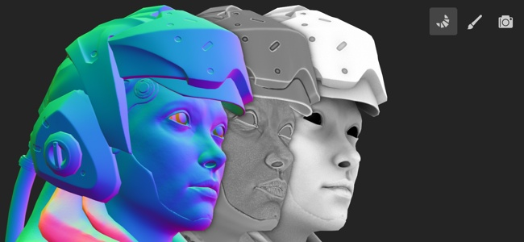

# Baking

La esegue i baking fa riferimento all&#39;azione di **trasferimento di informazioni basate su trama nelle texture**. Queste informazioni vengono quindi lette dagli shader e/o dai filtri Substance per creare effetti avanzati. Ad esempio, Materiali avanzati e Maschere avanzate si basano su curvatura e mappa normale eseguite i baking, insieme ad altre informazioni eseguite i baking.

In Painter la esegue i baking viene effettuata tramite la modalità di Esegue i baking dedicata. È possibile accedere a questa modalità tramite l&#39;icona dedicata (piccolo cornetto nella barra degli strumenti contestuale), utilizzando il [menu di modalità](../interface/main-menu/mode-menu.md) o con la [scelta rapida da tastiera da tastiera](../interface/settings/shortcuts.md).

Per ulteriori informazioni sulla procedura di esegue i baking in Painter, consultate le pagine seguenti:

* [Interfaccia della modalità di esegue i baking](baking-interface.md)
* [Come eseguire i baking le mappe trama](how-to-bake-mesh-maps.md)
* [Eseguire i baking le impostazioni di visualizzazione](baking-visualization-settings.md)
* [Correzione dell&#39;inclinazione](skew-correction.md)

Per una rapida panoramica della modalità di Esegue i baking, guardate il nostro tutorial video:

>[!NOTE]
>
> Per ulteriori informazioni sulla esegue i baking in generale, consulta la [Documentazione di Esegue i baking](https://experienceleague.adobe.com/en/docs/substance-3d/bakers/home) dedicata.