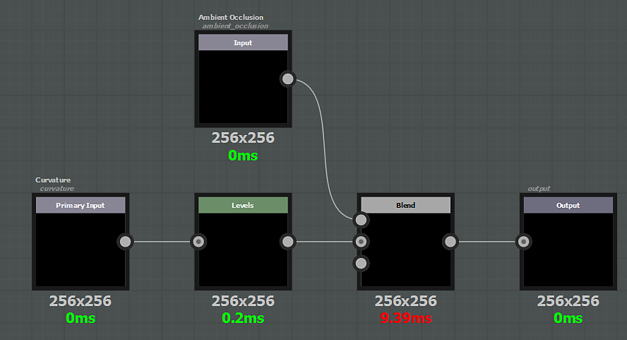

# Generatori

Un generatore si comporta come un filtro, la differenza è che non ci sono nodi di input diversi dalle mappe aggiuntive. Per leggere un canale dal set di texture, dovete creare un filtro.

