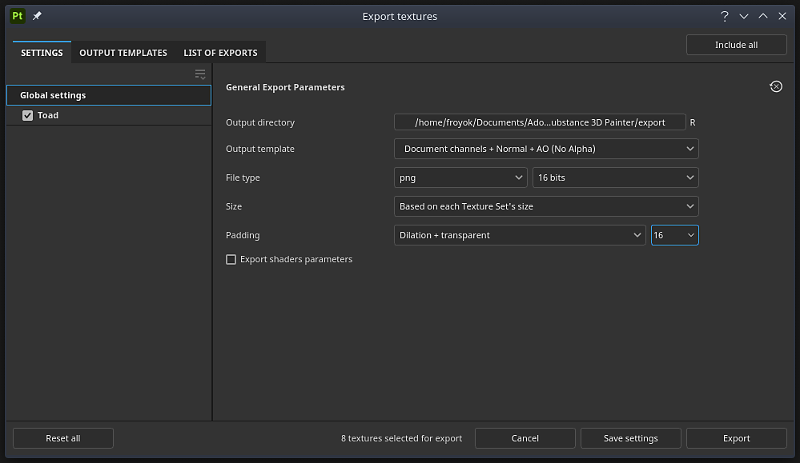

# Finestra Esporta

{width="500px"}

Aprite la <b>finestra Esportazione </b>con <b>File > Esporta texture </b>o scelta rapida da tastiera da tastiera <b>Ctrl + Maiusc + E</b>.

La finestra <b>Esporta </b> è suddivisa in tre schede:

* [Impostazioni di esportazione](export-settings.md)
* [Modelli di output](output-templates.md)
* [Elenco delle esportazioni](list-of-exports.md)

Nella parte inferiore della finestra sono presenti diversi pulsanti:

* <b>Reimposta tutto</b> (solo nella <b>scheda Impostazioni</b>): reimposta la configurazione di esportazione del progetto.
* <b>Annulla</b>: chiudi la finestra senza salvare le modifiche.
* <b>Salva impostazioni</b>: salva le impostazioni di esportazione correnti nel progetto.
* <b>Esportazione</b>: avviate l&#39;esportazione con le impostazioni di esportazione correnti e passate automaticamente alla sezione <b>Elenco di esportazioni</b> per tenere traccia dell&#39;avanzamento dell&#39;esportazione.
