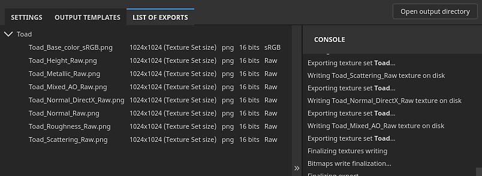

# Elenco delle esportazioni

{width="550px"}

Nell&#39;<b>Elenco della scheda di esportazione </b> della <b>finestra Esporta </b> sono elencate le texture esportate da ogni set di texture, con una console che indica lo stato dell&#39;esportazione, inclusi i messaggi di errore.
