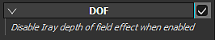

# Profondità di campo

La **Profondità del campo** (DOF) non ha parametri diretti. Se questa opzione è attivata, **sovrascriverà** il valore DOF da **Iray**.

Per controllare l&#39;aspetto del DOF nella finestra della vista, sono disponibili due impostazioni tramite la fotocamera:

| *Impostazione* | *Descrizione* |
| --- | --- |
| **Distanza focale** | Definisce la distanza alla quale si trova il punto focale.  Questo punto viene utilizzato dall’effetto Profondità campo. 

 **Nota:** la distanza focale può essere impostata automaticamente facendo clic su un punto della trama con il **tasto CTRL + pulsante centrale del mouse della scelta rapida da tastiera.** |
| **Apertura** | Definisce l’ampiezza della Profondità di Campo. 

 **Nota:** se Iray controlla questo parametro, modificandolo verrà riattivato un calcolo. |
