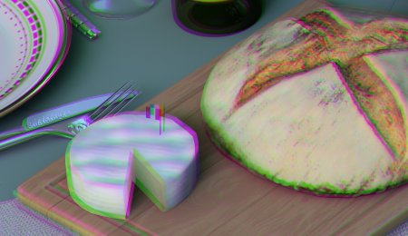

# Aberrazione laterale

Simula l’aberrazione cromatica spostando i canali di colore verso l’esterno dal centro dell’immagine, riproducendo le smarginature di colore visibili ai bordi dell’obiettivo della videocamera reale.

| <b>Parametro</b> | <b>Descrizione</b> |
| --- | --- |
|  |  |
| --- | --- |
| <b>Importo</b> | Controlla l’intensità dell’effetto di smarginatura del colore. Valori più alti producono una separazione del canale più pronunciata verso i bordi. |
| <b>Raggio</b> | Controlla le dimensioni dell’area centrale non interessata. Valori più bassi avvicinano l’effetto di aberrazione al centro, influendo su una porzione maggiore dell’immagine. |
| <b>Morbidezza</b> | Controlla lo smoothness della transizione tra il centro corretto e i bordi aberrati. |
| <b>Rapporto</b> | Imposta le proporzioni dell’area interessata. Un valore pari a 1 crea una forma circolare, mentre valori superiori a 1 creano un motivo ellittico più ampio. |
| <b>Centro X</b> | Posizione orizzontale del centro ottico da cui si irradia l’aberrazione. |
| <b>Centro Y</b> | Posizione verticale del centro ottico da cui si irradia l&#39;aberrazione. |
| <b>Aberrazioni cromatiche</b> | Cambia i colori dell&#39;aberrazione da quelli standard arcobaleno ai toni verde/viola. |
