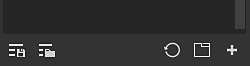

# Risorse

La finestra Risorsa consente di accedere alle risorse predefinite fornite con l&#39;applicazione (denominate **Risorse per iniziare**) e a eventuali risorse [importate](https://helpx.adobe.com/substance-3d/unlisted/documentation/spdoc/adding-content-to-the-shelf-142213317.html) (che possono essere trovate in **Le tue risorse**).

* Su disco, la libreria delle **risorse per iniziare** è archiviata nella cartella di installazione dell&#39;applicazione, mentre le risorse importate nella libreria delle **risorse** per impostazione predefinita si trovano nella cartella Documenti.
* Per ulteriori informazioni sulla posizione di archiviazione delle risorse sul disco, vedere [Aggiunta di contenuto sul disco rigido](../../content/importing-assets/adding-content-on-the-hard-drive.md).
* È anche possibile aggiungere una diversa posizione della libreria. Per informazioni, consulta [Aggiunta di una nuova libreria](adding-a-new-library.md).

## Panoramica

Per impostazione predefinita, la finestra Risorse è suddivisa in tre sezioni principali:

1. Area filtro
1. Elenco delle risorse
1. Barra inferiore

### Area filtro

Per ulteriori informazioni, vedere [Pagina di navigazione](navigation.md).

#### Elenco risorse

#### Barra inferiore

