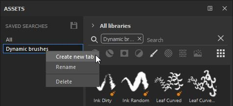

# Scheda Sub-libreria

Una sub-libreria è una nuova scheda o finestra in Substance 3D Painter dedicata a una ricerca specifica.\
Per impostazione predefinita, non è aperta alcuna scheda della libreria secondaria, ma solo la finestra principale Risorse. È possibile creare schede delle librerie secondarie dalla finestra principale Risorse utilizzando due metodi:

* **Facendo clic con il pulsante destro del mouse** su una delle ricerche salvate e scegliendo **Crea nuova scheda.**

* **scegliendo o immettendo una query di ricerca** (tramite tipi di risorse, breadcrumbs, query di testo o filtro in base a percorso) e quindi utilizzando il **pulsante** dedicato nella parte inferiore della finestra Risorse.

La creazione di una libreria secondaria creerà automaticamente una nuova scheda e **la ancorerà** nell&#39;interfaccia nello stesso spazio della finestra principale Risorse.

Da qui, la finestra della sub-libreria può essere ancorata in qualsiasi altro punto o lasciata mobile in qualsiasi punto dell&#39;interfaccia o su un altro schermo.

>[!NOTE]
>
> * Una sub-libreria ha le stesse caratteristiche della finestra principale delle risorse, ma quando viene reimpostata, tornerà alla query di ricerca originale.
> * A differenza della finestra principale Risorsa, se chiudi una libreria secondaria, questa dovrà essere ricreata.
> * Se una ricerca salvata viene rimossa, la finestra della libreria secondaria continuerà a esistere fino a quando non verrà chiusa.
