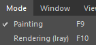

# Menu Modalità

Dal menu Modalità, è possibile passare da un&#39;interfaccia all&#39;altra per lavorare su attività diverse. Ogni modalità ha uno scopo e un’interfaccia dedicati a cui non è possibile accedere da altre modalità.

| Azione | Descrizione |
| --- | --- |
| **Esegue i baking mappe trama** | Utilizza questa modalità per creare mappe di utilità come normali, normali nello spazio mondo, AO e mappe ID, eseguendo i baking da high-poly a low-poly o utilizzando solo la trama del progetto stessa. |
| **Pittura** | Dove passerete la maggior parte del tempo in Painter, la modalità Pittura è il punto in cui potete accedere alla Pila livelli e ai materiali e alla pittura direttamente sui modelli 3D. |
| **Rendering (Iray)** | Passa alla modalità di rendering Iray. Iray è un modulo di rendering non in tempo reale che può creare rendering di alta qualità. Per ulteriori informazioni, consulta la pagina dedicata: [Modulo di rendering Iray](../../features/iray-renderer/iray-renderer.md). |
