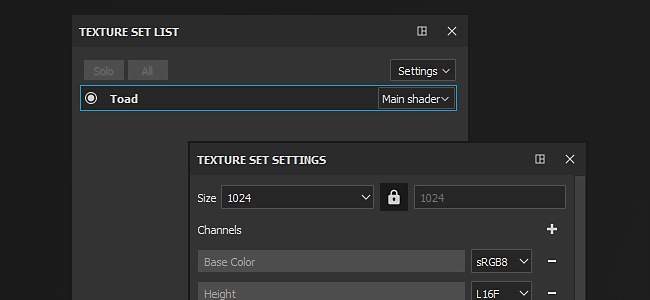

# Set di texture

Substance 3D Painter creerà automaticamente un nuovo set di texture ogni volta che trova un ID materiale su una trama importata ([a meno che un progetto non utilizzi il flusso di lavoro Porzione UV](../../features/uv-tiles/uv-tiles.md)).

Ogni ID materiale deve avere UV univoci (o sovrapposizioni logiche per la geometria specchiata).

Per ulteriori dettagli sulle proprietà e sulle manipolazioni del **set di texture**, vedere:

* [Elenco Set di texture](texture-set-list.md)
* [Impostazioni set texture](texture-set-settings.md)
* [Riassegnazione set di texture](texture-set-reassignment.md)
