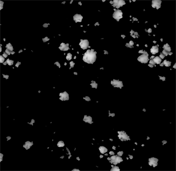

# Pittura mappa altezza

## Idea generale

Lavorare su una mappa di altezza invece di lavorare direttamente su una normale offre diversi vantaggi, come una migliore qualità, un migliore controllo, flessibilità e una migliore coerenza tra le risorse.

La procedura è la seguente:

* Una mappa normale, eseguita i baking da una trama poly alta, viene caricata sulla trama poly bassa.
* Pittura ulteriori dettagli sul canale heightmap.
* Il Height pittura viene composto attraverso tutti i livelli e convertito in mappa normale in tempo reale, per poi essere fuso con la normale della trama poly più alta.

Tutto ciò di cui devi preoccuparti è dipingere quel height, tutto il resto viene fatto automaticamente.

### Formato height HDR

Il canale di Height utilizza un formato di colore **HDR**, che consente di pittura valori positivi e negativi senza mai raggiungere un limite di luminosità, contrariamente alle tradizionali mappe di altezza che saturano tra 0 e 255.

* Quando colorate con una bitmap o una sostanza su un height, tale sorgente viene rimappata dal suo intervallo [0,255] originale a un intervallo [-1,1].

Un grigio medio verrà rimappato su 0. Pertanto, i valori inferiori a 127 **substrattano** dalla mappa di altezza, mentre i valori superiori a 127 **vi aggiungono** quando si utilizza il metodo di fusione predefinito impostato per le mappe di altezza, **Scherma lineare (Aggiungi)**.

* Quando colorate con un colore normale, potete selezionare direttamente valori compresi tra -1 e 1.

### Visualizzazione height

Quando si visualizza la mappa dell’altezza in modalità Solo, l’anteprima predefinita mostra solo valori positivi, con una forte saturazione del nero per valori negativi.

L&#39;impostazione **+/- color** consente di visualizzare l&#39;intero intervallo utilizzando un colore diverso per i valori positivi e negativi.

L&#39;impostazione **Scala** consente di modificare l&#39;intervallo visibile di quella mappa HDR nel caso in cui tu abbia aggiunto o sottratto più dell&#39;intervallo predefinito [-1,1].

<table>
<tr style="border: 0;">
<td style="border: 0;" valign="top">

</td>
<td style="border: 0;" valign="top">

</td>
</tr>
</table>
