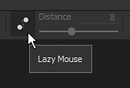
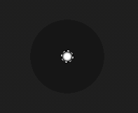

# Mouse lento

Il Mouse lento è uno scostamento di distanza tra il cursore del mouse e il disegno effettivo che consente di pittura tratti più precisi o uniformi.

Può essere attivata tramite la [barra degli strumenti contestuale](../interface/toolbars.md). Semplifica la pittura con linee continue e pulite.

## Abilitazione del Mouse lento

Per attivare o disattivare il Mouse lento, è sufficiente fare clic sul pulsante disponibile nella barra degli strumenti contestuale:

Una volta abilitata questa opzione, dovrebbe essere visibile un cerchio grigio attorno al cursore del pennello nella finestra della vista:

## Raggio Mouse lento

Nella barra degli strumenti contestuale è possibile modificare la distanza del Mouse lento. La distanza definisce un raggio entro il quale i timbri del pennello verranno dipinti dalla posizione originale della pittura. Più piccola è la distanza, più presto i francobolli saranno dipinti che consente rapidi giri ma riducono l&#39;arrotondamento della linea dipinta.

* Grande distanza :

  {width="400px"}
* Piccola distanza:

  {width="400px"}
