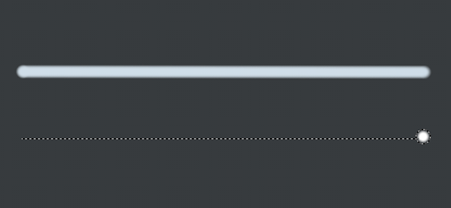

# Linea retta

La linea dritta è un modo semplice per disegnare una linea con qualsiasi strumento di pittura, con meno clic e più precisione.

Si tratta di una modifica applicata temporaneamente con l’aiuto di una scelta rapida da tastiera da tastiera.

La posizione della linea retta viene calcolata dalla finestra della vista, il che significa che se tra un tratto e l’altro della fotocamera viene spostata, la successiva linea retta potrebbe essere posizionata in modo errato.

## Abilitazione della linea retta

Basta premere &quot;Maiusc&quot; sulla tastiera quando è selezionato uno strumento di pittura per visualizzare le linee punteggiate che indicano il tracciato che lo strumento pittura seguirà. Quando si preme &quot;Maiusc&quot;, facendo clic in un punto qualsiasi si disegna la linea.

{width="400px"}

## Aggancio a linea retta

Oltre a &quot;Maiusc&quot; è anche possibile premere &quot;Ctrl&quot; per agganciare la linea retta ogni 5 gradi.

{width="400px"}
