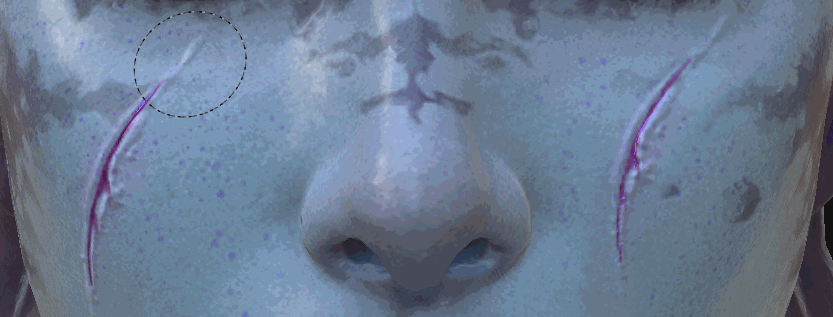

# Strumento clone

Introdotto in Substance 3D Painter 2, lo strumento Clona /Clone condivide lo stesso tipo di parametri dello [strumento pittura](https://support.allegorithmic.com/documentation/display/SPDOC/Paint+brush). Come suggerisce il nome, lo strumento Clona consente di duplicare il contenuto di un livello specifico o dell’intera Pila livelli da un punto all’altro.

## Utilizzo

Il modo più semplice per usare lo strumento Clona /Clone è usarlo sul contenuto di un livello di pittura.

Questa operazione può essere eseguita in 2 passaggi:

* Selezionare la posizione di origine posizionando il mouse sul modello e premendo il tasto &quot; **V** &quot;.
* Quindi posizionate il mouse nel punto in cui verrà visualizzata l’area duplicata e iniziate a colorare.

È possibile aggiornare l&#39;origine in qualsiasi momento premendo nuovamente &quot; **V** &quot;.

Per impostazione predefinita, quando colorate con lo strumento Clona, la posizione di origine segue e aggiorna la sua posizione una volta rilasciato il pennello. Disabilitando il pulsante utilizzato per il &quot; **comportamento Clona /Clone origine** &quot;, l&#39;origine tornerà al punto definito quando si preme &quot; **V** &quot;. Questo può essere utile quando colorate più volte con la stessa area sorgente.

Un modo più intelligente di utilizzare lo strumento Clona /Clone consiste nel creare un livello di pittura e impostare il metodo di fusione di tutti i canali su &quot;Attraversa&quot;. Ciò consentirà di duplicare qualsiasi informazione in modo non distruttivo da tutti i livelli che si trovano sotto il &quot;livello Clona /Clone&quot;. I livelli sottostanti rimangono intatti e tutte le modifiche applicate in seguito verranno prese in considerazione dal livello Clona /Clone:

