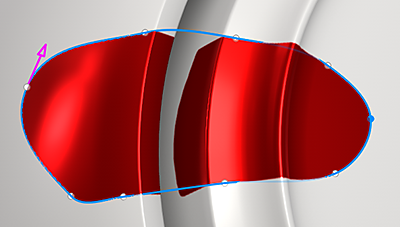

# Percorso riempito

Lo strumento tracciato pieno è un tipo di strumento tracciato che consente di creare forme sulla superficie del modello 3D riempito con un colore uniforme.

È possibile accedere allo strumento <b>Percorso riempito</b> dal menu Strumenti tracciato:

## Impostazioni

Le impostazioni di Riempimento tracciato sono:

| Impostazione | Descrizione |
| --- | --- |
| Opacità | Controllate l&#39;opacità finale della forma piena. |
