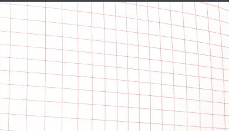

# Riempimento poligono

Lo strumento **Riempimento poligonale** riempie i poligoni con valori di canale di materiale o valori di maschera in scala di grigio. Può essere utilizzato su livelli di pittura, effetti e maschere per riempire rapidamente le aree della trama.

Questo strumento è più uno strumento di pittura che uno di selezione: ecco perché, una volta utilizzato, può essere cancellato solo tramite lo strumento gomma o riempiendolo.

È possibile accedere allo strumento dalla barra degli strumenti:

## Impostazioni

Di seguito è riportato l&#39;elenco delle impostazioni disponibili con lo strumento **Riempimento poligonale** tramite la finestra **Proprietà**.

### Modalità di selezione

La modalità di selezione controlla la modalità di selezione dei triangoli e dei quad della geometria della trama.

| **Modalità** | **Descrizione** |
|---|---|
|  **Riempimento selezione rettangolare** | Disegnate una selezione rettangolare facendo clic e trascinando. La **modalità di riempimento** definisce la geometria da riempire, mentre la **prova di accesso** definisce i poligoni da includere.    |
|  **Riempimento ciclo poligono** | Riempi un ciclo completo di quad con un solo clic. Il trascinamento seleziona più loop.    |
|  **Riempimento parziale del loop poligonale** | Riempire una parte di un ciclo facendo clic e trascinando. La selezione può estendersi lungo loop secondari per formare una patch di poligoni.    |

### Modalità di riempimento

La modalità di riempimento, che può essere utilizzata solo con la modalità **Riempimento selezione rettangolare**, controlla quali parti della geometria sono selezionate.

| **Modalità** | **Descrizione** |
|---|---|
|  **Riempimento triangolare** | Riempite i singoli triangoli della trama. |
|  **Riempimento poligono** | Riempire interi poligoni. Su una trama triangolata prima dell&#39;importazione, il risultato è lo stesso di **Riempimento triangolo**. |
|  **Riempimento trama** | Riempi ogni poligono connesso a quello su cui hai fatto clic. |
|  **Riempimento blocco UV** | Riempi poligoni collegati nello spazio UV. Il riempimento si ferma ai bordi UV. |

### Test hit

Le impostazioni del test di attivazione controllano la modalità di selezione dei triangoli e dei quad dalla modalità **Riempimento selezione rettangolare**.

| **Modalità** | **Descrizione** |
|---|---|
|  **Intersezione** | (impostazione predefinita) Un poligono viene riempito se una qualsiasi parte della sua geometria si trova all&#39;interno o interseca l&#39;area di selezione. |
|  **Centro contenuto** | Un poligono viene riempito solo se il suo punto centrale si trova all’interno dell’area di selezione. |
| **Solo poligoni visibili** | Se questa opzione è attivata, il riempimento agisce solo sui poligoni visibili nella vista videocamera corrente. I poligoni occlusi e rivolti all&#39;indietro vengono ignorati. Se disattivata, i poligoni possono essere riempiti attraverso la trama. |

### Fusione

Queste impostazioni controllano il modo in cui il risultato del riempimento viene miscelato con i pixel sottostanti.

| **Parametro** | **Descrizione** |
|---|---|
| Metodo fusione | Controlla il modo in cui il riempimento viene fuso con i valori dei pixel esistenti. In modalità **Materiale**, il metodo di fusione si applica a tutti i canali abilitati nella sezione **Materiale**. |
| Opacità | Controllate l’opacità del riempimento. |

>[!NOTE]
>
> Lo strumento supporta gli stessi metodi di fusione disponibili nella Pila livelli. Per ulteriori informazioni, consulta la [pagina della documentazione sui metodi di fusione](https://experienceleague.adobe.com/it/docs/substance-3d-painter/using/interface/layer-stack/blending-modes).

### Materiale

La sezione del materiale controlla quali canali possono essere attivati dall&#39;utensile per la pittura.

## Scelte rapide

Lo strumento Riempimento poligonale può essere utilizzato in modo efficace con l’aiuto di scelte rapide da tastiera specifiche:

| **Scelta rapida da tastiera** | **Descrizione** |
|---|---|
| **Alt** | Con **Riempimento loop poligonale** e **Riempimento loop poligonale parziale**, questa scelta rapida da tastiera estende la selezione dall’altra parte del clic iniziale durante il trascinamento.    |
| **Maiusc** | Con **Riempimento parziale del loop poligonale**, questa scelta rapida da tastiera riempie solo il loop principale, ignorando i loop secondari. Esempio di attivazione/disattivazione di **Maiusc**:    |
| **Maiusc + A** | Questa scelta rapida da tastiera passa temporaneamente a **Riempimento a ciclo poligonale** da qualsiasi altra modalità di selezione. Se la scelta rapida da tastiera viene rilasciata prima del pulsante del mouse, la selezione continua fino al rilascio del pulsante. |
| **A** | Se questa scelta rapida da tastiera viene premuta durante il trascinamento, il risultato corrente viene combinato con il risultato precedente. Funziona con metodi di fusione e opacità:    |

## Limitazioni

Lo strumento presenta alcune limitazioni:

* **Il riempimento del loop poligonale** e il **riempimento parziale del loop poligonale** funzionano solo su quad, quindi i triangoli e gli n-goni non possono essere riempiti con queste modalità.
* Anche il supporto per **simmetria radiale** è limitato e potrebbe non essere affidabile. Per usare simmetria preferisci usare invece la modalità speculare. Per ulteriori informazioni, vedere la [pagina della documentazione di simmetria](https://experienceleague.adobe.com/it/docs/substance-3d-painter/using/painting/symmetry/symmetry).
* Lo strumento riempie la geometria solo dal **set di texture attivo**. Il wireframe viene visualizzato per tale set di texture e viene aggiornato quando cambia il set di texture attivo.
