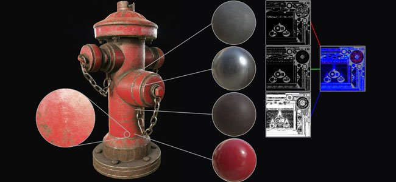
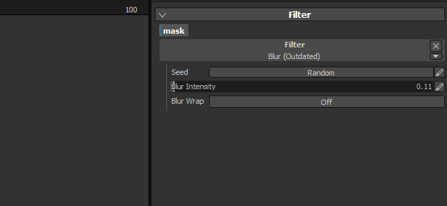

# Versione 2.2

**Substance Painter 2.2** aggiunge un nuovo flusso di lavoro, ovvero la Stratificazione dinamica dei materiali.

Data di pubblicazione: *21 luglio 2016*

## Caratteristiche principali

### Nuovo flusso di lavoro Stratificazione dinamica dei materiali

Con questa nuova versione viene aggiunto un nuovo **flusso di lavoro** denominato **Livellamento dei materiali**. I flussi di lavoro tradizionali per la creazione di texture si basano sulla creazione di texture ad **alta risoluzione** per **mantenere i dettagli**, ma questo **risulta scomodo** per i casi d&#39;uso. Un approccio più interessante consiste invece nella **creazione di un piccolo materiale di lavorazione** e nella **ripetizione all&#39;interno di uno shader**. Consente di mantenere una certa qualità e la possibilità di **ingrandire molto vicino** all&#39;oggetto utilizzando questo shader **senza perdere dettagli**. L&#39;unico problema è che per visualizzare in anteprima il risultato finale era in precedenza obbligatorio andare al motore di gioco/renderer che visualizzano lo shader finale. Ciò non è più vero in quanto in questa nuova versione è ora possibile utilizzare uno shader simile all&#39;interno della Substance Painter, che consente di **visualizzare contemporaneamente il risultato finale e la pittura**.

È stato aggiunto un **nuovo progetto di esempio** denominato &quot;**FireHydrant**&quot; per presentare il nuovo flusso di lavoro.

Questo nuovo flusso di lavoro consente due metodi di lavoro:

* I materiali sono definiti nello shader, puoi solo pittura le maschere per fonderle
* Materiali e maschere possono essere dipinti insieme

In ogni caso, è possibile definire ogni volta una nuova Pila livelli che offre maggiore libertà durante la creazione delle maschere e dei materiali. La gestione dei livelli è molto più semplice in questo modo e ogni pila può avere un proprio insieme di canali specifici che possono essere fusi nello shader finale.\
Abbiamo anche uno shader speciale per Unity 5 e Unreal Engine 4 disponibile su Share :

* [Unità 5](https://share.allegorithmic.com/libraries/2126)
* [Unreal Engine 4](https://share.allegorithmic.com/libraries/2125)

Per ulteriori informazioni, consulta la pagina dedicata della documentazione: [Stratificazione dinamica dei materiali](../../features/dynamic-material-layering.md)

### Nuovo campo di ricerca per scaffali

Abbiamo migliorato il **mini scaffale** che appare in varie posizioni dell&#39;applicazione con un campo di ricerca dedicato. Questo miglioramento rende la ricerca delle risorse molto più intuitiva e piacevole da usare. La ricerca personalizzata viene mantenuta durante la sessione corrente dell&#39;applicazione. Se, ad esempio, si utilizzano molti rumori di grunge, l&#39;utilizzo di questa parola chiave determinerà

## Esercitazione

L&#39;ultima esercitazione video illustra le nuove funzioni:

## Note sulla versione

### 2.2.0

(Pubblicato il 21 luglio 2016)

**Aggiunto:**

* [Shelf] Miglioramento del sistema di ricerca e delle query
* [Shelf] Aggiungi campo di ricerca per i mini-scaffali
* [Shader] Consente di definire la precisione dei passi per i cursori
* [Shader] Aggiungi un pulsante Annulla/Ripeti per i parametri di shader
* [Shader] Il ricaricamento di uno shader non dovrebbe ripristinarne i parametri
* [MatLayering] Aggiungi il supporto per Stratificazioni dinamiche del materiale e sottopile
* [MatLayering] Consenti di importare il file json per configurare le impostazioni di shader
* [MatLayering] Sblocca il limite dei campionatori texture (passa a texture senza binding)
* [Scripting] Consenti di impostare le impostazioni dei baker e avviare il calcolo
* [Substance] Utilizzo per connessioni di input/output oltre agli identificatori
* [Tool] Consente di selezionare il canale di anteprima nella finestra della vista per lo strumento di proiezione

**Risolto:**

* Arresto anomalo all&#39;avvio se le sostanze si trovano in una cartella errata
* Il report di Arresto anomalo a volte non funziona a causa di un file di registro errato
* [Iray] Gli Effetti post non si aggiornano quando Iray è in pausa
* [Iray] La scelta rapida da tastiera con messa a fuoco automatica non funziona più
* [Iray] Il comportamento del cursore Apertura varia a seconda delle dimensioni della risorsa
* [Livelli] Il primo canale di materiale non è attivato per impostazione predefinita se è disattivato
* [Shader] Se un &quot;parametro automatico&quot; non è corretto, non viene stampato alcun errore

**Problema noto:**

* [Mac] Il limite di campioni di Texture è bloccato su 16 (problema driver GPU)
