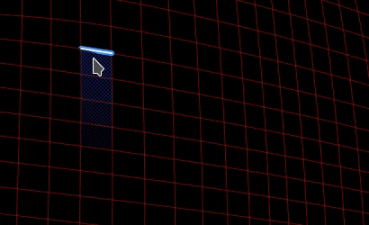
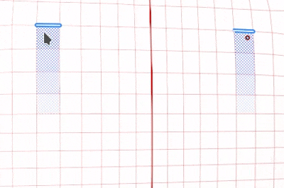
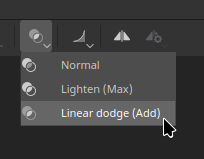
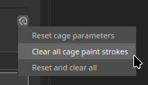
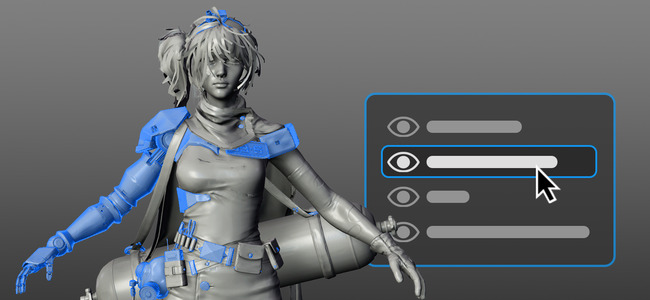

# Versione 12.2

**Substance 3D Painter 12.2** offre uno strumento Riempimento poligonale migliorato con selezione basata su loop, pittura a gabbia per la esegue i baking, evidenziazione del set di texture nella finestra della vista e trasparenza indipendente dall&#39;ordine per il rendering in tempo reale.

Data di pubblicazione: **21 ottobre 2026**

## Funzioni principali

### Riempimento poligonale migliorato

Lo strumento **Riempimento poligonale** è stato rielaborato con una nuova interfaccia e nuove modalità di selezione per i loop poligonali. Lo strumento ora supporta anche i metodi di fusione con un controllo dell’opacità e può funzionare su più canali contemporaneamente. Anche l’occlusione delle maniglie di selezione, che indica che i poligoni nascosti dalla videocamera vengono ignorati.

* **Interfaccia migliorata**

  Le impostazioni **Riempimento poligonale** nella finestra **Proprietà** sono state rielaborate per semplificarne l&#39;utilizzo. Le opzioni sono ora visualizzate come righe di pulsanti, per velocizzare il passaggio da una modalità all’altra. Le nuove icone delle descrizioni comandi descrivono il funzionamento di ciascuna modalità.

  

* **Nuove modalità di selezione**

  Alla riga **Modalità di selezione** sono state aggiunte due nuove modalità dedicate ai loop poligonali:

  

  * **Riempimento ciclo poligonale**: questa modalità riempie un ciclo completo di quad con un solo clic. Tenendo premuto **Alt** durante il trascinamento, la selezione si estende anche nella direzione opposta.

    

  * **Riempimento parziale del ciclo poligonale**: questa modalità riempie solo una parte di un ciclo e trascinando lungo il ciclo si estende la selezione. Durante il trascinamento, le frecce mostrano il flusso della topologia su ciascun lato della selezione per aiutare a prevedere cambiamenti di percorso imprevisti. Una descrizione comandi accanto al cursore mostra il numero di poligoni selezionati su entrambi gli assi. Tenendo premuto **Alt** durante il trascinamento, la selezione si estende anche nella direzione opposta.

    

  Tenendo premuto **Maiusc + A** si passa temporaneamente anche a **Riempimento a ciclo poligonale** da qualsiasi modalità di selezione. Se la scelta rapida da tastiera viene rilasciata prima del pulsante del mouse, la selezione continua fino al rilascio del pulsante.

* **La modalità di riempimento cambia la modalità di selezione**

  Le opzioni della **modalità di riempimento** non si applicano alle modalità **Riempimento ciclo poligonale** e **Riempimento ciclo poligonale parziale**. Per questo motivo, selezionando una modalità di riempimento, la **modalità di selezione** tornerà automaticamente a quella principale.

  

* **Nuova opzione Hit-test**

  La nuova opzione **Hit-test** controlla quali poligoni sono inclusi nell&#39;area di selezione. L&#39;eliminazione dei poligoni non visibili è ora il comportamento predefinito poiché l&#39;opzione **Solo poligoni visibili** è abilitata per impostazione predefinita. Se si disabilita questa opzione, viene ripristinato il precedente comportamento di riempimento della trama.

  Le opzioni disponibili sono:

  * **Intersezione**: (impostazione predefinita) un poligono viene riempito se una sua parte si trova all&#39;interno dell&#39;area di selezione o ne attraversa il bordo.
  * **Centro contenuto**: un poligono viene riempito solo se il suo punto centrale si trova all&#39;interno dell&#39;area di selezione.
  * **Solo poligoni visibili**: se attivata, questa opzione riempie solo i poligoni visibili dalla visualizzazione della videocamera corrente. La geometria occlusa e rivolta all&#39;indietro viene quindi ignorata.

  

* **Metodi di fusione e opacità**

  Lo strumento **Riempimento poligonale** ora supporta tutti i metodi di fusione, lo stesso elenco di quello disponibile nella Pila livelli. **Scherma lineare (Aggiungi)**, ad esempio, aggiunge valori a quelli esistenti anziché sostituirli. Le modalità sono disponibili nella nuova sezione **Fusione** della finestra **Proprietà** oltre a un cursore **Opacità**. In modalità **Materiale**, il metodo di fusione si applica a tutti i canali abilitati nella sezione **Materiale**.

  

* **Riempire più canali contemporaneamente**

  Lo strumento **Riempimento poligonale** non è più limitato a un singolo canale. Tutte le proprietà dei canali abilitate nella sezione **Materiale** possono ora essere impostate e inserite in un&#39;unica azione.

  

* **Compatibile con simmetrie**

  Anche **Riempimento ciclo poligonale** e **Riempimento ciclo poligonale parziale** funzionano con simmetria. Un singolo clic funziona con la simmetria a specchio (la simmetria radiale potrebbe tuttavia essere meno affidabile).

  

* **Riprendi tratto precedente**

  La scelta rapida da tastiera **Riprendi tratto precedente** (mantenendo premuto **A**) ora funziona con lo strumento **Riempimento poligonale**, anche tra i metodi di fusione e le opacità.

  

* **Feedback più chiaro tra set di texture**

  Il wireframe viene ora visualizzato solo per il set di texture attivo e viene aggiornato quando la selezione cambia. Passando con il mouse sulla geometria da un altro insieme di texture, viene visualizzato un cursore non consentito per indicare che la geometria correlata non può essere riempita.

  

>[!NOTE]
>
> Per ulteriori informazioni sullo strumento **Riempimento poligonale**, consultate la [pagina dedicata alla documentazione](https://experienceleague.adobe.com/it/docs/substance-3d-painter/using/painting/paint-tools/polygon-fill).

### Nuovo dipinto a gabbia in modalità di Eseguita i baking

La nuova **modalità di pittura a gabbia** è uno scostamento della gabbia per pixel che può essere colorato sopra lo scostamento della distanza globale. Ciò significa che la gabbia può ora essere regolata colorando direttamente sulla trama. Le zone in cui la maglia poly alta va al di fuori della gabbia possono quindi essere fissate localmente più facilmente.

* **Nuovo disegno dell&#39;offset della gabbia**

  Un nuovo pulsante **Pittura gabbia** in modalità di Eseguita i baking passa ora alla modalità di pittura della gabbia. In questa modalità è possibile utilizzare gli strumenti **Pittura**, **Gomma** e **Riempimento poligonale** per regolare la distanza della gabbia dalla trama poly bassa.

  

  Questa operazione viene eseguita colorando una texture intermedia. Questa texture viene quindi utilizzata come offset sulla trama della gabbia durante la esegue i baking. Questa operazione è simile al processo **disegno con inclinazione**.

  Un parametro **Intensità** nella barra degli strumenti superiore imposta il valore di scostamento applicato dal tratto. Sono disponibili anche i controlli **Dimensioni**, **Flusso**, **Opacità tratto** e **Spaziatura**, nonché un pulsante **Inverti valore**. È supportata anche la simmetria.

  

  

* **Usa Riempimento poligonale per selezionare e riempire intere parti di trama**

  Lo strumento **Riempimento poligonale** consente di regolare contemporaneamente la distanza di gabbia di sottooggetti parziali o completi. Facendo clic su un elemento si apre una barra degli strumenti mobile con un cursore **Intensità gabbia**. Questo cursore fa crescere o rimpicciolire la gabbia in tempo reale, a partire dal valore impostato nella barra degli strumenti superiore. Gli scostamenti colorati vengono quindi aggiunti sopra l’offset.

  

* **Visualizza offset gabbia nella finestra della vista**

  Quando si entra in modalità di applicazione della griglia, la finestra della vista passa a una nuova modalità di visualizzazione. In questa modalità, gli scostamenti sono visibili come una sovrapposizione verde sulla gabbia. La gabbia viene deformata anche per rappresentare la rete della gabbia utilizzata durante il processo di eseguita i baking.

  

  Alcune impostazioni possono essere controllate tramite il pannello **Visualizzazione Eseguente i baking**: la sezione **Gabbia** controlla la **superficie della gabbia** e la **superficie della gabbia** e la relativa opacità. Ha anche un&#39;**opacità della griglia di offset** e un&#39;**intensità dell&#39;ombreggiatura di offset**.

  

* **Metodo di fusione nella barra degli strumenti contestuale**

  Alcuni metodi di fusione sono disponibili direttamente nella barra degli strumenti contestuale. Possono essere utilizzati per regolare più facilmente lo scostamento della gabbia, in particolare per aggiungere o sottrarre scostamenti.

  Le modalità disponibili sono:

  * **Normale**: sostituisce l&#39;offset esistente con il valore di traccia.
  * **Schiarisci (massimo)**: mantiene il valore più alto del tratto e l&#39;offset esistente.
  * **Scherma lineare (Aggiungi)**: (impostazione predefinita) aggiunge il valore di traccia all&#39;offset esistente.

  

  Altri metodi di fusione sono disponibili con **Riempimento poligonale** utilizzando il menu di scelta rapida nella finestra della vista.

* **Nuovo menu di reimpostazione per il disegno con gabbia e inclinazione**

  Le modalità Inclinazione e Pittura a gabbia ora hanno entrambe un nuovo menu per ripristinare le impostazioni. Le opzioni disponibili sono:

  * **Reimposta parametri gabbia/inclinazione**: reimpostare i parametri dell&#39;interfaccia utente sui valori predefiniti.
  * **Cancella tutte le tracce pittura di ingombro/inclinazione**: cancella la texture utilizzata per la gabbia o il disegno di inclinazione.
  * **Ripristina e cancella tutto**: combina la reimpostazione dell’interfaccia utente con la cancellazione delle texture di inclinazione/gabbia.

  

>[!NOTE]
>
> Per ulteriori informazioni sulla esegue i baking, consultate la [pagina dedicata alla documentazione](https://experienceleague.adobe.com/it/docs/substance-3d-painter/using/baking/baking).

### Evidenziazione di un nuovo set di texture nella finestra della vista

Il nuovo comportamento di evidenziazione consente ora di identificare le geometrie nella finestra della vista 3D associate a un **set di texture** o a una **Porzione UV**.

* **Evidenziazione dall&#39;elenco Set di texture**

  Posizionando il puntatore del mouse su una voce nell&#39;**elenco Set di texture**, la relativa geometria viene ora evidenziata nella finestra della vista, sia per gli insiemi di texture che per le Porzioni UV. In questo modo è più facile capire quale parte della trama appartiene a ciascun set di texture.

  

* **Evidenzia dalla finestra della vista**

  Tenendo premuto **Ctrl/Comando + Alt** sul modello viene evidenziata la geometria dell&#39;insieme di texture sotto il cursore. L’evidenziazione viene nascosta quando si preme il pulsante sinistro del mouse o si effettua il panning e ritorna quando i modificatori vengono rilasciati.

* **Disponibile nelle modalità Pittura e Esegue i baking**

  L’evidenziazione funziona sia nella modalità di colorazione che in quella di esegue i baking. In modalità di esegue i baking, gli insiemi di texture disattivati vengono visualizzati in grigio quando sono evidenziati.

### Nuova trasparenza indipendente dall&#39;ordine

Il riquadro di visualizzazione in tempo reale supporta ora la trasparenza indipendente dall&#39;ordine. Vengono rimossi gli artefatti di ordinamento e lo sfarfallio che possono verificarsi quando si sovrappongono più superfici trasparenti o traslucide.

* **Nuova opzione nelle impostazioni dello schermo**

  L&#39;opzione **Trasparenza indipendente dall&#39;ordine** può essere abilitata nella sezione **Impostazioni rendering** delle **Impostazioni schermo**. È disattivata per impostazione predefinita per evitare che ciò influisca sulle prestazioni.

  

  Prima e dopo l’attivazione della nuova impostazione:

  

* **Controllo delle prestazioni**

  Un parametro **Capacità ordinamento** controlla il numero medio di livelli di trasparenza che è possibile ordinare per pixel. Valori più alti migliorano la qualità della trasparenza nelle scene complesse, ma possono utilizzare più memoria e ridurre le prestazioni. Le opzioni disponibili sono:

  * **Bassa (1x)**.
  * **Media (2x)**.
  * **Alta (4x)** (impostazione predefinita)
  * **Molto alto (8x)**
  * **Ultra (16x)**

### Miglioramenti vari

In questa versione sono state aggiunte funzioni e miglioramenti aggiuntivi:

* **Impostazioni schermo riorganizzate**

  I parametri della finestra **Impostazioni schermo** sono stati raggruppati e riordinati, per facilitare la navigazione del pannello. Le impostazioni sono ora suddivise in **Impostazioni ambiente**, **Impostazioni fotocamera**, **Effetti post**, **Impostazioni rendering** e **Impostazioni visualizzazione**. Una riga di pulsanti nella parte superiore della finestra consente di passare direttamente a ciascun gruppo.

  

* **Fusione additiva con tratti pennello**

  Le impostazioni del pennello ora offrono un nuovo metodo di fusione aggiuntivo. In questa modalità, i tratti si sommano l’uno sull’altro nello stesso livello, anziché sostituirsi l’uno con l’altro. Questo non è limitato ai timbri all’interno di un tratto. Con questa nuova modalità il colore può essere aggiunto in modo aggiuntivo oppure il canale height può essere scolpito aggiungendo o rimuovendo valori.

  

* **Nuova mappa del motore adiacente UV**

  È disponibile un nuovo input mappa motore `mesh_uv_neighbor` per i materiali e i filtri Substance. Funziona come una texture di avvezione UV per trovare l&#39;altro lato di una cucitura Isola UV. I suoi canali rosso e verde memorizzano l&#39;avversione UV utilizzata per raggiungere il pixel adiacente attraverso una giunzione UV.

  Per ulteriori informazioni su queste texture di motori, vedere la [pagina dedicata alla documentazione](https://experienceleague.adobe.com/it/docs/substance-3d-painter/using/content/creating-custom-effects/mesh-based-input).

## Note sulla versione

### 12.2.0

Data di pubblicazione: **2026/10/21**

Riepilogo: **Questo aggiornamento è una versione principale, aggiunge una nuova funzionalità di pittura in gabbia per la esegue i baking e apporta miglioramenti alla funzionalità di riempimento poligono. Per ulteriori dettagli, vedere le note sulla versione complete.**

**Aggiunto:**

* Eseguo i baking, pittura a gabbia
* &lbrack;Cage Painting&rbrack; Creazione di un&#39;interfaccia utente di base per la Pittura della gabbia
* &lbrack;Cage Painting&rbrack; Nuove opzioni di visualizzazione della gabbia
* &lbrack;Cage Painting&rbrack; Strumento Selezione/Riempimento Modificabile
* &lbrack;Cage Painting&rbrack; Mostra modalità Fusione nella barra degli strumenti
* &lbrack;Cage Painting&brack; modifiche interfaccia utente del cursore HDR
* &lbrack;Cage Painting&rbrack; shader di visualizzazione
* &lbrack;Cage Painting&rbrack; Ripristina opzioni pila
* Miglioramenti dello strumento Riempimento poligono
* &lbrack;Polygon Fill&brack; Aggiungi patch poligonale
* &lbrack;Polygon Fill&brack; Aggiungi loop poligonale
* &lbrack;Polygon Fill&rbrack; supporto Simmetria con loop/Patch
* &lbrack;Polygon Fill&rbrack; Simmetria anteprima bordi
* &lbrack;Polygon Fill&brack; Rimuovi triangoli con loop e loop parziali
* &lbrack;Polygon Fill&rbrack; Wireframe visibile solo per il set di texture attivo
* &lbrack;Riempimento poligonale&rbrack; evidenziazione dei bordi rossi su triangoli non selezionabili
* &lbrack;Riempimento poligonale; Non disabilitare le opzioni della modalità di riempimento
* &lbrack;Riempimento poligono&rbrack; Consenti di impostare tutte le proprietà del canale con Riempimento poligono
* &blocca;Riempimento poligono&nna; Riprendi tratto precedente funziona con Riempimento poligonale
* &lbrack;Riempimento poligonale; Mostra cursore non consentito su set di texture non attivi
* &blocco;Riempimento poligono&rnco; Anteprima istantanea ALT
* &lbrack;Polygon Fill&rbrack; Scelta rapida da tastiera per il passaggio temporaneo a Polyloop (MAIUSC+A)
* &lbrack;Riquadro di visualizzazione&rbrack; Mostra set di texture/Porzione UV selezione evidenziata
* &lbrack;Viewport&rbrack; Aggiungi il supporto per Trasparenza indipendente dall&#39;ordine nella finestra della vista in tempo reale
* &lbrack;Impostazioni di visualizzazione&rbrack; riorganizza le impostazioni di visualizzazione in nuovi gruppi
* &lbrack;Strumento&rbrack; Aggiungi il supporto per la fusione additiva con tratti pennello
* &lbrack;Strumento&rbrack; Aggiungi supporto per fusione additiva con Riempimento poligonale
* &lbrack;USD&rbrack; L&#39;USD esportato con mappa di opacità rende tutto trasparente in Arnold
* &lbrack;Nvidia&rbrack; Aggiungi avviso sui driver Nvidia più recenti (da 616.56 a 617.14)
* Aggiungi nuovo input mappa motore &quot;mesh_uv_next&quot;
* Aggiornare i baker alla versione 3.23.0
* Aggiornamento del motore di Substance alla versione 9.6.1

**Corretto:**

* &lbrack;Esegui i baking&rbrack; Occlusione ambientale L&#39;opzione Ignora backface per nome trama non funziona
* &lbrack;Esegue i baking&rbrack; &lbrack;AMD&rbrack; Dispositivo perso durante la esegue i baking con trame pesanti e ad alto polio
* &lbrack;Performance&rbrack; Painter nasconde l&#39;utilizzo dell&#39;VRAM
* &lbrack;Viewport&rbrack; texture mancanti all’apertura di progetti su schermi HDPI
* &lbrack;Strumento&rbrack; Il metodo di fusione è disattivato quando si disegna in una maschera
* Cartelle temporanee non eliminate dopo l’esportazione in rete
* &lbrack;USD&rbrack; La geometria USD esportata viene divisa lungo i bordi UV
* &lbrack;USD&rbrack; Blocco durante il caricamento di USDz in formato non valido
