# Versione 8.3

**Substance 3D Painter 8.3** introduce una nuovissima modalità di esegue i baking, l&#39;importazione di file USD e il supporto per la dimensioni fisiche in modalità Proiezione UV.

Data di pubblicazione: *10 gennaio 2023*

## Caratteristica principale

### Nuova modalità di esegue i baking

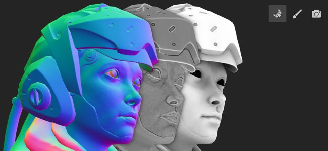

La vecchia finestra di esegue i baking è stata sostituita da una modalità dedicata con diverse nuove funzioni, in particolare con la visualizzazione della finestra della vista come la visualizzazione della gabbia e gli errori corrispondenti.

* **Accesso e passaggio da una modalità all&#39;altra**\
  Eseguire i baking è ora una modalità nuova e separata, che si aggiunge alle modalità di disegno e rendering dell’applicazione già esistenti. Per passare alla modalità di esegue i baking, è sufficiente utilizzare l’icona a forma di piccolo cornetto nella barra degli strumenti contestuale. Il passaggio da una modalità all’altra può essere eseguito in altro modo: utilizzando il menu della modalità o le scelte rapide da tastiera. Per tornare a un&#39;altra modalità, è sufficiente utilizzare l&#39;icona dedicata della modalità. Inoltre, è possibile utilizzare il pulsante **Esegue i baking mappe trama** all&#39;interno delle [impostazioni del set di texture](../interface/texture-set/texture-set-settings.md) per passare alla nuova modalità.

  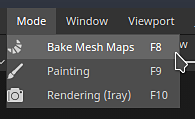

  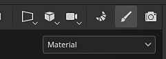

* **Nuova interfaccia della modalità**\
  La tradizionale finestra di esegue i baking è stata Trasforma in una modalità con docks dedicati, in particolare:

  * **È possibile utilizzare l&#39;elenco di set di texture** per definire le parti del progetto che verranno eseguite i baking.
  * **I Baker di mappe trama** consentono di scegliere tra le impostazioni di esegue i baking comuni e le impostazioni di baker. È inoltre possibile specificare il processo di baker da avviare.
  * **Impostazioni mappa trama** contiene tutte le impostazioni comuni e del baker e può essere modificato in base alla selezione effettuata nelle due finestre precedenti.
  * **Il registro di Esegue i baking** raggruppa informazioni diverse sul processo di esegue i baking, in particolare messaggi di errore.
  * **visualizzazione Eseguita i baking**: questo pannello si trova nella finestra della vista e controlla diverse opzioni relative alla visualizzazione delle trame poly bassa e alta.

  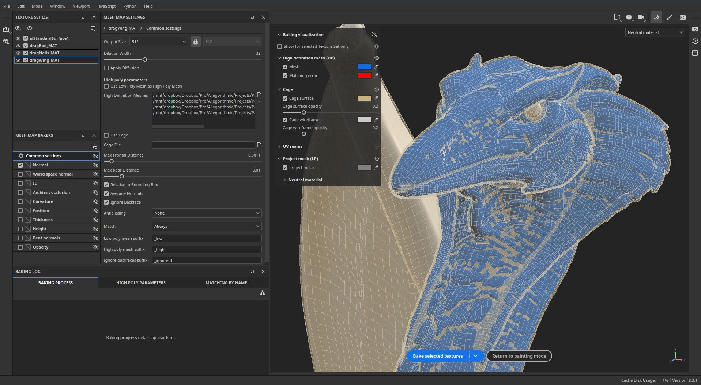{width="500px"}

* **Avviare e annullare il processo di esegue i baking direttamente dalla finestra della vista**\
  Il pulsante che consente di avviare o annullare la esegue i baking si trova ora nella parte inferiore della finestra della vista. Potete anche usare una piccola freccia per specificare la modalità di esegue i baking: in base alla selezione dell’elenco Set di texture o utilizzando l’insieme di texture attualmente attivo.

  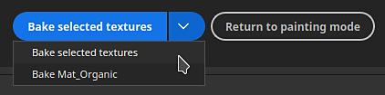

  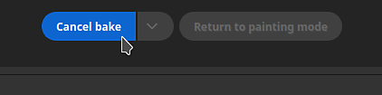

* **Visualizza trama ad alto poly nella finestra della vista**\
  Quando si specifica una trama High-Poly nelle impostazioni di esegue i baking, questa viene caricata anche nella finestra della vista (a meno che l’impostazione di visualizzazione dedicata non sia disattivata). Ciò consente di verificare se la geometria della trama poly bassa e alta corrispondono correttamente.

  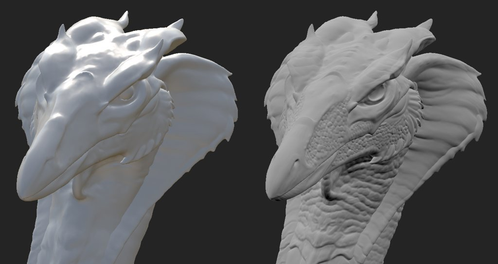{width="400px"}

* **Visualizza mesh gabbia nella finestra della vista con aree mancanti come errore**\
  La trama della gabbia può essere visualizzata anche nella finestra della vista. Quando non si utilizza un file mesh dedicato, viene visualizzata una gabbia implicita che reagisce al parametro Distanza frontale massima. Quando si regola la dimensione della gabbia, qualsiasi parte della trama ad alto poli che si trova al di fuori della gabbia sarà mostrata come rossa per impostazione predefinita, consentendo di trovare facilmente parte della trama che non sarà eseguita i baking.

  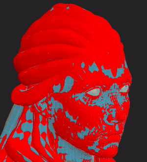

* **Controllare la trama durante il caricamento e l&#39;eseguo i baking**\
  Caricando trame e eseguendo i baking non si blocca più l&#39;applicazione, il che significa che è possibile interagire con la finestra della vista durante tali operazioni. Ciò può essere utile per analizzare il eseguo i baking in corso, identificare tempestivamente i problemi e annullare il eseguo i baking, contribuendo a risparmiare tempo alla fine. Analogamente, verrà eseguito i baking per primo il set di texture più visibile nella finestra della vista, per verificare in anticipo i risultati in aree specifiche.

  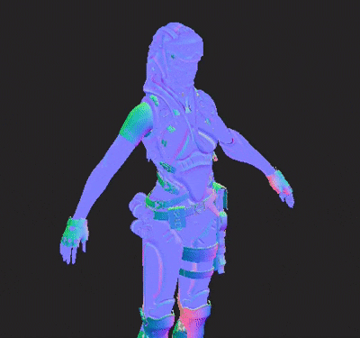

* **Impostazioni neutre del materiale e del viewport**\
  Per mettere a fuoco i risultati della esegue i baking e cercare eventuali problemi, la modalità di esegue i baking non visualizza texture dipinte, ma utilizza un materiale neutro. Le impostazioni di questo materiale neutro possono essere regolate nel pannello di visualizzazione Eseguito i baking all&#39;interno della finestra della vista.

  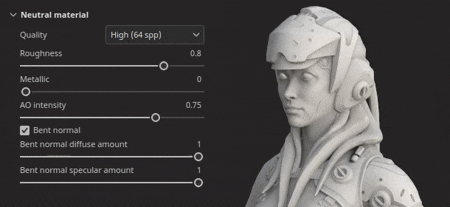

* **Visualizzazione di bordi rigidi con cuciture UV mancanti**\
  Una fonte di artefatti quando si esegue i baking è la presenza di bordi netti che non hanno giunture UV. Questo può portare a linee visibili e interrompere lo smoothness di ombreggiatura. A questo scopo, sono state aggiunte delle impostazioni di visualizzazione per evidenziarle sia in 3D che in Vista 2D, dato che possono essere ignorate con facilità.

  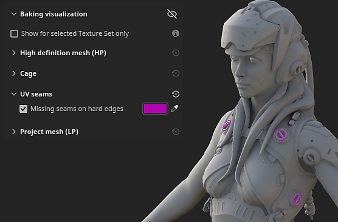{width="450px"}

  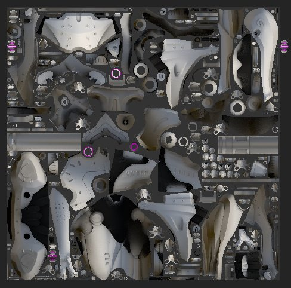{width="300px"}

* **Sincronizzare e annullare la sincronizzazione dei parametri**\
  La nuova azione di sincronizzazione consente di specificare quale parte delle impostazioni di Esegue i baking deve essere sincronizzata tra set di texture. In caso contrario, sarebbe noioso configurare le impostazioni più volte in modo identico. A volte è utile avere degli insiemi di texture con impostazioni dedicate e tenerli non sincronizzati. Ad esempio, mantenendo separate le impostazioni Comuni ora è possibile utilizzare una Distanza frontale massima, una Risoluzione e/o un elenco di trame ad alto poli che sarebbero diverse per Set di texture.

  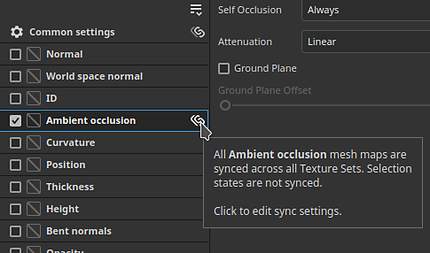{width="400px"}

  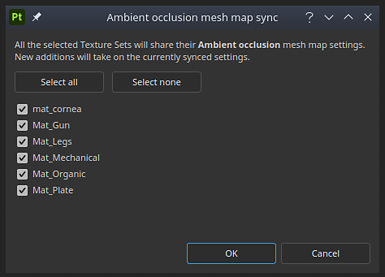{width="400px"}

* **Corrispondenza per controllo nomi**\
  La scheda **Corrispondenza per nome** nel **Registro di Esegue i baking** può aiutare a trovare gli errori nel processo di corrispondenza prima di eseguire i baking, rendendo più facile notare trame che non corrispondono. Le trame corrispondenti vengono raggruppate insieme, mentre le altre vengono isolate e visualizzate in rosso.

  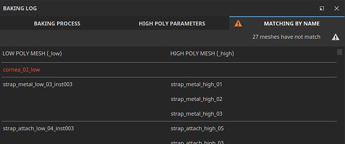{width="450px"}

>[!NOTE]
>
> In questa nuova modalità sono presenti molte altre nuove impostazioni. Per ulteriori informazioni, consulta la [pagina dedicata alla documentazione](../baking/baking.md).

### Nuova importazione ed esportazione di file USD

Questa nuova versione aggiunge il supporto del formato di file [Universal Scene Description (USD)](https://graphics.pixar.com/usd/release/intro.html). Ora è possibile avviare un progetto Painter, esportando trame e texture utilizzando un formato USD, che garantisce un flusso di lavoro più coerente tra le applicazioni.

* **Importa il file USD con varianti, skin e in un fotogramma specifico**\
  Un formato di file USD può essere utilizzato quando si crea un progetto o si reimporta una trama all’interno di un progetto. I file USD possono spesso essere scene complesse, pertanto un selettore ambito e variante è disponibile anche per importare solo un sottoinsieme del file.

  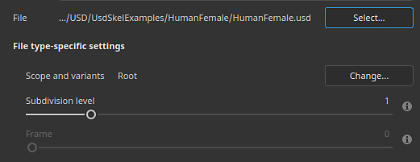{width="400px"}

  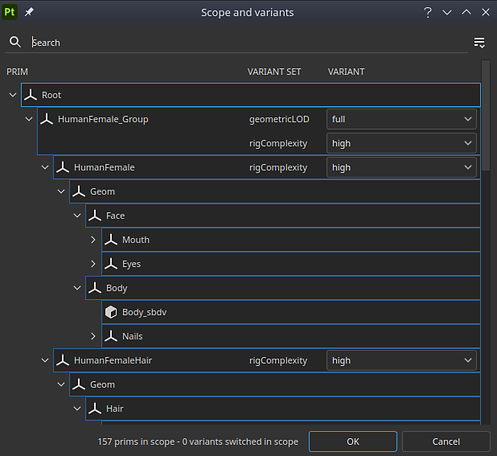{width="400px"}

* **Esporta USD come nuovo file o collegato all&#39;USD originale utilizzato nel progetto**\
  Quando la texture è pronta, potete utilizzare la finestra **File > Esporta texture** per esportare il file USD insieme ai file di texture. È sufficiente abilitare l&#39;impostazione **Esporta risorsa USD**. In questo modo verranno generati diversi file USD che potranno essere facilmente integrati in una pipeline successiva. Se avete utilizzato un file non USD o un file USD senza UV, verrà esportato un nuovo file di geometria USD oltre a mappe texture e file materiale USD.\
  È inoltre possibile utilizzare **File > Esporta trama** per esportare la geometria del progetto come file USD.

  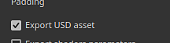

  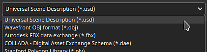{width="400px"}

### Supporto migliorato della dimensioni fisiche in modalità UV

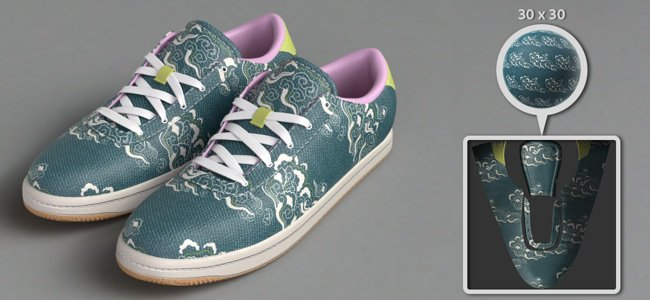

Il supporto dei materiali delle Substance con dimensioni fisiche incorporata è stato esteso alle proiezioni basate sui raggi UV.

* **Dimensioni fisiche in modalità UV**\
  Ora è possibile impostare il metodo Scala su Dimensioni fisiche invece di Affiancamento nel livello di riempimento e negli effetti di riempimento utilizzando il metodo Proiezione UV. La dimensione dell&#39;UV viene calcolata automaticamente in base alla dimensione media dei triangoli dallo srotolamento UV.

  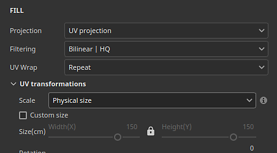{width="400px"}

* **Passa automaticamente a dimensioni fisiche**&#x200B;È stata aggiunta una nuova impostazione di progetto per impostare automaticamente la scala su dimensioni fisiche durante la creazione di un materiale (ad esempio, durante il trascinamento di una risorsa per la finestra Risorsa). In questo modo è possibile usare il ridimensionamento uniforme in un progetto senza dover cambiare manualmente le impostazioni ogni volta che viene creato un nuovo livello di riempimento. Per abilitarla in un progetto esistente, vai a **Modifica > Configurazione progetto** e abilita **Dimensioni fisiche scala livelli di riempimento quando assegni i materiali**. Questa impostazione può essere attivata anche durante la creazione di un nuovo progetto.

  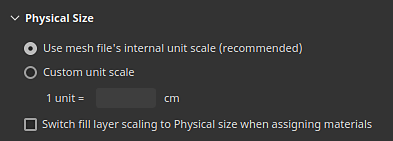

## Informazioni sul supporto della piattaforma

Con questa versione è stata aumentata la versione minima supportata di Painter su Steam a Ubuntu 20.04.

## Tutorial

Per scoprire e scoprire la nuova modalità di Esegue i baking, seguite il nostro tutorial più recente:

## Note sulla versione

*(Rilasciato: 10 gennaio 2023)*\
Riepilogo: **Versione principale con nuova modalità di esegue i baking, nuova importazione ed esportazione di file USD e supporto di dimensioni fisiche per Proiezione UV**

**Aggiunto:**

* [Modalità di Esegue i baking] Nuova modalità di esegue i baking dedicata alla esegue i baking
* [Modalità Eseguita i baking] Imposta scelta rapida da tastiera per passare alla modalità eseguita i baking su F8
* [Modalità di Esegue i baking] Pulsante Aggiungi inizio e Annulla esegue i baking nella finestra della vista
* [Modalità di Esegue i baking] Aggiungete una selezione eseguita i baking nell’elenco Set di texture
* [Modalità di Esegue i baking] Aggiungere una nuova finestra Baker mappa trama per selezionare i baker
* [Modalità di Esegue i baking] Aggiungere una nuova finestra Impostazioni mappa trama per modificare le impostazioni di esegue i baking
* [Modalità di Esegue i baking] Aggiungere una nuova finestra Log di Esegue i baking per seguire la procedura di esegue i baking
* [Modalità di Esegue i baking] Aggiungi parametri di esegue i baking e annulla le azioni nella finestra della cronologia
* [Modalità di Esegue i baking] Aggiungi breadcrumbs nelle impostazioni Mesh Map
* [Modalità di Esegue i baking] Aggiungere miniature di mappe trama nella finestra Baker mappe trama
* [Modalità di Esegue i baking] Aggiungi menu comprimibile delle impostazioni di visualizzazione nella finestra della vista 3D
* [Modalità Eseguita i baking] Aggiungi impostazione di visualizzazione per mostrare/nascondere la trama High-Poly
* [Modalità Eseguita i baking] Aggiungi impostazione di visualizzazione per mostrare/nascondere la trama della gabbia e il wireframe
* [Modalità Eseguita i baking] Aggiungi impostazione di visualizzazione per mostrare/nascondere la trama low-poly
* [Modalità di Esegue i baking] Aggiungi impostazione di visualizzazione per mostrare bordi netti senza giunture UV come errori
* [Modalità di Esegue i baking] Fornisci informazioni sulla trama nella finestra della vista e esegue i baking gli errori se Esegue i baking registro non è visibile
* [Modalità di Esegue i baking] Aggiungi azione per sincronizzare le impostazioni del baker tra tutti i set di texture

  Nella finestra Baker mappa trama, è possibile sincronizzare ciascun baker (e le impostazioni comuni) tra set di texture facendo clic sull’icona di collegamento accanto al nome del gruppo. Questa azione consente di aprire una finestra che consente di selezionare quali set di texture condivideranno gli stessi parametri.
* [Modalità di Esegue i baking] Aggiungi azioni per copiare e incollare le impostazioni del baker

  Nella finestra Baker mappa trama sono disponibili le azioni per copiare e superare le impostazioni di ciascun baker nei set di texture, tramite il menu dedicato nella parte superiore della finestra o il menu di scelta rapida (clic con il pulsante destro del mouse).
* [Modalità di Esegue i baking] Pulsante Aggiungi in Esegue i baking registro per passare da un errore alle impostazioni corrette

  Quando un baker si guasta o una trama non viene caricata correttamente, nel Registro di Esegue i baking viene visualizzato un messaggio di errore. Un pulsante accanto al messaggio consente di modificare la finestra Baker mappa trama e Impostazioni mappa trama per visualizzare le relative impostazioni. In questo modo è possibile isolare più facilmente la fonte di un problema per poterlo risolvere.
* [Modalità di Esegue i baking] Aggiungete menu per gestire set di texture e selezioni di Baker

  Sia nella finestra &quot;Elenco set texture&quot; che nella finestra &quot;Baker mappa trama&quot; sono stati aggiunti un piccolo menu di azioni che consente di copiare e invertire le selezioni.
* [Modalità di Esegue i baking] Suddividi l’elenco di selezione dei baker per set di texture
* [Modalità di Esegue i baking] Dividere le impostazioni comuni per set di texture
* [Modalità di Eseguita i baking] Caricare mesh di poli e gabbia ad alta densità senza bloccare l&#39;interfaccia
* [Modalità di Esegue i baking] Utilizzare la barra di avanzamento della finestra della vista per visualizzare il caricamento della trama
* [Modalità di Esegue i baking] Aggiungere lo stato di caricamento della trama nel registro di Esegue i baking
* [Modalità di Esegue i baking] Consente di ruotare la trama nella finestra della vista durante la esegue i baking
* [Modalità di Esegue i baking] Imposta l’ordine di esegue i baking in base alla visibilità della finestra della trama corrente
* [Modalità Eseguita i baking] Visualizza gabbia eseguita i baking implicita nella finestra della vista

  Quando non si utilizza un file di mesh di gabbia personalizzato, viene generata e visualizzata una mesh di gabbia automatica nella finestra della vista. Le sue dimensioni si basano sul parametro Distanza frontale massima dalle impostazioni comuni eseguite i baking. La maglia della gabbia viene utilizzata per indicare la distanza di corrispondenza tra il poly basso e alto.
* [Modalità di Esegue i baking] Mostra l&#39;elenco corrispondente dei nomi di mesh per Corrispondenza per nome nel registro di Esegue i baking
* [Modalità di Eseguo i baking] Usare materiale neutro per visualizzare il modello 3D nella finestra della vista
* [Modalità di Esegue i baking] Disattiva il calcolo del motore in modalità di esegue i baking
* [Modalità di Esegue i baking] Visualizza un avviso quando si esce dall’app mentre è in corso un eseguo i baking
* [Baker] Aggiornare le etichette delle impostazioni di antialiasing

  I valori delle impostazioni di antialiasing sono stati rinominati &quot;Supersampling&quot; e con un numero moltiplicatore esplicito per chiarirne il comportamento.
* [Baker] Aggiorna i baker alla versione 2.5.7.
* [USD] Importare ed esportare file di Universal Scene Description (USD)
* [USD] Aggiungere le opzioni USD alla finestra Nuovo progetto quando si seleziona un file USD
* [USD] Aggiungi nuova finestra di selezione Ambito e varianti

  Quando si importa un file USD, facendo clic sul pulsante di modifica nella finestra Nuovo progetto o Configurazione progetto è possibile selezionare la parte e le varianti di un file USD da importare.
* [USD] Opzione Aggiungi livelli di suddivisioni

  Quando si crea un nuovo progetto con un file mesh USD che contiene suddivisioni, è possibile selezionare il livello di suddivisioni utilizzando un cursore. Il progetto verrà creato con la trama suddivisa. Il livello può essere modificatore tramite Configurazione progetto.
* [USD] Importare maglie con pelle USD a un fotogramma specifico

  Quando si crea un nuovo progetto con un file mesh USD che contiene animazioni, è possibile selezionare il fotogramma utilizzando un cursore che riflette la sequenza temporale incorporata. Il fotogramma può essere modificatore tramite Configurazione progetto.
* [USD][Esporta] Aggiungi un’opzione per esportare i file USD

  Nuova casella di controllo Esporta USD aggiunta alla finestra Esporta texture. Quando è selezionato, consente di esportare file USD e mappe texture utilizzando qualsiasi modello.
* [USD][Esporta] Aggiungere il formato di file USD all’esportazione con trama
* [USD] Rinomina il predefinito di esportazione &quot;Rugosità metallo USD PBR&quot; esistente per renderlo più esplicito

  Il modello di esportazione USD precedentemente noto come &#39;Rugosità metallo USD PBR&#39; è ancora accessibile tramite Esporta texture > Modello di output > USDz (Apple AR).
* [Annullamento automatico] Aggiungi orientamento blocco per impacchettamento

  Nuova opzione per lo scorrimento automatico delle impostazioni che consente di mantenere l’orientamento delle Isole UV esistenti quando si utilizza la funzione di impacchettamento. È possibile accedervi da Nuovo progetto > Opzioni Srotolamento automatico > Isola UV orientamento.
* [Dimensioni fisiche] Aggiungi impostazione per utilizzare automaticamente la Dimensioni fisiche nell’effetto/livello di riempimento

  È stata aggiunta una nuova opzione che consente di passare automaticamente alla scala dimensioni fisiche quando si utilizza un materiale con dimensioni fisiche incorporata. Può essere attivato per ogni progetto tramite Nuovo progetto o tramite Modifica > Configurazione progetto > Dimensioni fisiche > Converti il ridimensionamento del livello di riempimento in Dimensioni fisiche quando si assegnano i materiali.
* [Dimensioni fisiche] Esposizione dimensioni fisiche per Proiezione UV

  Il ridimensionamento delle dimensioni fisiche è ora disponibile per le Proiezioni UV: consente di ridimensionare automaticamente un materiale in base alla dimensioni fisiche di una trama. Può essere selezionata da Scala > Dimensioni fisiche nel livello di riempimento o nella finestra Proprietà effetti.
* [Scripting][Python] Consenti di eseguire query sulla versione dell’applicazione
* [Scripting][JavaScript] Aggiorna l’API in base ai nuovi parametri di esegue i baking
* [Scripting][Python] Modulo di Esegue i baking: modifica parametri di esegue i baking
* [Scripting][Python] Modulo di Esegue i baking: avvia/annulla esegue i baking
* Modulo di Esegue i baking [Scripting][Python]: seleziona il metodo di curvatura
* [Scripting][Python] Modulo di Esegue i baking: selezione di baker/riquadri uv
* [Scripting][Python] Modulo di Esegue i baking: sincronizzare le impostazioni del baker tra tutti i set di texture
* [SVT] Abilitazione del supporto hardware di tipo sparse sulle GPU AMD

  L’accelerazione hardware per il sistema Sparse Virtual Textures può ora essere abilitata con le GPU AMD. Questa impostazione viene attivata automaticamente nelle preferenze generali.
* [Proiezione] Rinomina parametri proiezione cilindrica

  Il parametro &quot;Cylinder Culling&quot; è stato rinominato &quot;Backface Culling&quot; per rappresentarne meglio l’azione. La descrizione associata è stata modificata di conseguenza.
* [Project] Salva la versione dell&#39;applicazione nel progetto e recuperala tramite script

  A partire dalla versione 8.2, la versione dell’applicazione viene ora memorizzata nel file spp durante il salvataggio.\
  Questo numero di versione può essere recuperato con la funzione last\_saved\_substance\_painter\_version() nel modulo di progetto dell’API Python.\
  Per i progetti realizzati prima della versione 8.2, il valore restituito sarà null.
* [Import] Migliorare i tempi generali di importazione dei modelli 3D

  Abbiamo migliorato il tempo generale di importazione delle trame. Ad esempio, la riduzione del tempo di attesa durante il caricamento di trame a poli elevato per la esegue i baking. Questa ottimizzazione si applica in particolare al caricamento dei file OBJ.

**Corretto:**

* [Arresto anomalo] Cambiare i canali sul filtro con una pila specifica
* [Mac][M1] Arresto anomalo durante la creazione di un livello di riempimento e l&#39;uscita dalla Pila livelli

  Questo problema può essere risolto eseguendo l’aggiornamento a Mac OS 13 (Ventura).
* [Scripting][Python] Arresto anomalo di utilizzo di ui.add\_dock\_widget() con tipo errato
* [Esegue i baking] Messaggio di errore incompleto nel registro quando un eseguo i baking non riesce
* [Esegue i baking] La memoria non viene liberata al termine della esegue i baking
* [Engine] La cache della Texture non si aggiorna quando si modifica la visibilità degli effetti
* [Esporta] 2DView esporta in modo casuale la mappa uniforme
* [Progetto] Errore di allocazione della memoria durante il salvataggio del progetto con trama grande
* [Riquadro di visualizzazione] In alcuni casi, l’accesso automatico al contenuto causa artefatti durante l’uso del colore

**Problemi noti:**

* [Gestione colore] Le conversioni dello spazio cromatico HDR con ACE su Linux producono colori bloccati
* [Pila livelli] Sorgente di input non salvata per livello
* [Esporta] vista 2D esporta una mappa casualmente uniforme
