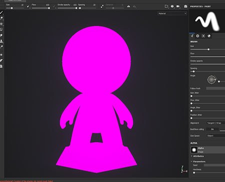

# La trama appare rosa nella finestra della vista

{width="400px"}

La trama può apparire **rosa** all&#39;interno della finestra della vista perché lo **shader** utilizzato per disegnarla **non viene più compilato** (come indicato dalla **finestra del registro** ). Ciò può essere causato da uno shader obsoleto che non supporta l&#39;ultima versione dell&#39;API shader.

Ecco come risolvere il problema:

* Per **shader predefiniti**: seguire la procedura dettagliata dalla pagina [Aggiornamento di uno shader](../../../interface/shader-settings/updating-a-shader.md).
* Per **shader personalizzato**: date un&#39;occhiata al messaggio di errore nella finestra del registro e alla pagina [API shader](https://helpx.adobe.com/it/substance-3d/unlisted/documentation/spdoc/custom-shader-api-89686018.html).
