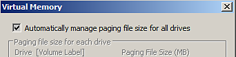
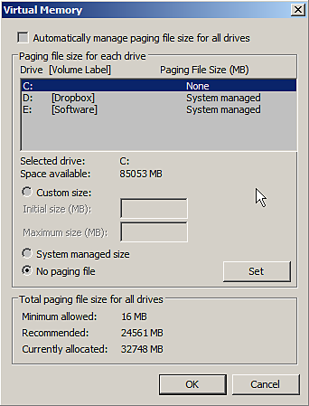

# Arresto anomalo con memoria virtuale insufficiente

Substance 3D Painter può essere instabile se il file di **paging** ( **scambia** memoria/ **memoria virtuale**) è impostato con un valore **troppo basso**.\
Si consiglia di lasciare che il sistema operativo gestisca queste impostazioni (che normalmente è il caso per impostazione predefinita). Per funzionare correttamente, Substance 3D Painter richiede **almeno** di **16 GB** di memoria virtuale.

## Come modificare le dimensioni della memoria virtuale in Windows?

>[!NOTE]
>
> La modifica delle dimensioni della memoria virtuale in Windows richiederà il riavvio del computer.

Accedere alle impostazioni della memoria virtuale effettuando le seguenti operazioni

1. Fai clic con il pulsante destro del mouse sull&#39;icona **Computer/Questo PC** e scegli **Proprietà**
1. Seleziona &quot;**Impostazioni di sistema avanzate**
1. Fare clic sul pulsante **Impostazioni** della sezione **Prestazioni**
1. Fare clic sulla scheda **Avanzate**
1. Fare clic su **Modifica** nella sezione **Memoria virtuale**

Ora è possibile:

* Attiva la casella di controllo **Gestisci automaticamente dimensioni file di paging per tutte le unità**

**o**

* Selezionare il disco rigido in cui si desidera modificare le dimensioni della memoria virtuale, scegliere **Dimensioni gestite dal sistema** e fare clic sul pulsante **Imposta**.

**Automatico:**

**Manuale:**

